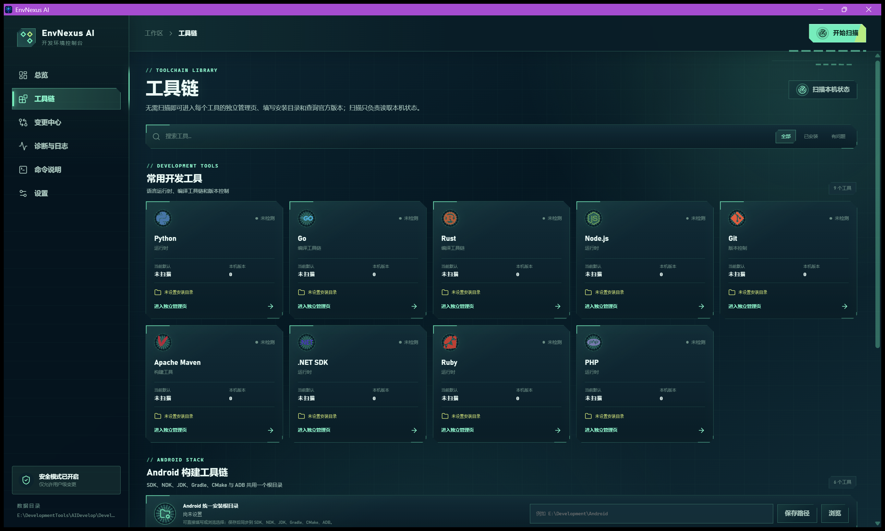

<p align="center">
  
</p>

<h1 align="center">EnvNexus AI</h1>

<p align="center">AI 辅助的 Windows 开发环境与多版本工具链管理器</p>

<p align="center">
  <a href="README.zh-CN.md">简体中文</a> |
  <a href="#english">English</a>
</p>

<p align="center">
  <a href="https://github.com/PuppetWen/EnvNexus-AI/releases/latest"></a>
  <a href="https://github.com/PuppetWen/EnvNexus-AI/releases"></a>
  <a href="https://github.com/PuppetWen/EnvNexus-AI/issues"></a>
  <a href="https://github.com/PuppetWen/EnvNexus-AI/stargazers"></a>
  
  
</p>



---

## 中文

EnvNexus AI 是一款使用 Rust + Tauri 2 开发的 Windows 桌面 App。它把常见开发工具的检测、官方版本查询、下载校验、自选目录安装、多版本切换、修复和卸载放到统一、安全且可回滚的工作流中。

当前发布版本为 **[0.1.8](https://github.com/PuppetWen/EnvNexus-AI/releases/tag/v0.1.8)**：修复版本列表重叠、窄列按钮布局及通知中的路径字形，并增加 Maven 的完整 JDK 依赖检查。本地前端与浏览器检查、[Windows CI2](https://github.com/PuppetWen/EnvNexus-AI/actions/runs/39095241423) 和[独立签名验证](https://github.com/PuppetWen/EnvNexus-AI/actions/runs/39095973235)均通过，包含 Maven 实际安装回归；六项公开资产的直接下载、逐项哈希比对与两包签名复验已通过；自动更新 latest 入口已无凭据回读确认为 0.1.8，哈希与发布清单一致。下文 0.1.7 的验证结果仅为历史记录。

### 主要功能

- 管理 Python、Java/JDK、Go、Rust、Node.js、Git、Maven、.NET SDK、Ruby、PHP，以及 Android SDK、NDK、JDK、Gradle、CMake、ADB。
- Python 查询合并官网发布数据库、历史归档及官方 CPython 版本标签，展示 0.9、1.x、Python 2、旧 Python 3 的稳定版和预览版；缺包、仅源码或不能自动安装的条目也会保留并说明原因。
- 官方版本支持关键词、发布类型和“仅可安装”筛选，可按版本或发布日期双向排序。
- Python 优先采用官方完整 PythonCore ZIP；旧版受支持的 Wise EXE / MSI / WiX Burn EXE 通过静态提取安装，保留完整标准库和原发行包的能力。
- 每个工具都有独立页面和独立安装根目录；Android 组件集中使用同一个用户指定根目录。
- 显示当前默认版本、本机全部版本、官方可安装版本、安装位置和环境状态。
- 官方版本列表优先显示已有缓存，过期内容在后台刷新；合并重复查询，安装前获取选中版本所需的校验信息。
- 手动全机扫描会遍历所有本地固定磁盘并建立索引；App 启动时只读取快照，安装、切换和修复后使用文件指纹增量刷新。
- 首次保存安装目录不会触发全盘扫描；尚无全机索引时，只检查配置目录和当前 PATH 中的工具。
- 增量刷新复用未变化工具的已验证版本，仅对新增或发生变化的可执行文件重新探测；手动全机扫描始终强制复核。
- 切换默认版本前显示用户级 PATH/环境变量差异、冲突、备份和确认计划；系统级修改默认拒绝。
- 安装完成后自动展示环境配置计划，可确认设为默认版本，也可选择仅保留安装。
- 支持断点续传、哈希校验、安全解压、暂存安装、失败回滚、环境备份、操作日志和诊断报告。
- 识别 pyenv-win、NVM for Windows、fnm、Volta、rustup、Jabba、goenv、rbenv、Uru 等版本管理器，并在诊断和修复建议中保护它们的 shim、链接与根目录。
- 生成 `jdk-list`、`python-install`、`env-diagnose` 等 CMD 脚本；脚本调用同一个主程序，可从任意新开的 CMD 或 PowerShell 使用。
- 支持现代科技、赛博朋克、日系轻量、游戏 HUD、专业极简主题，以及简体中文、繁体中文、English、日本語、한국어界面。
- 支持托盘菜单、开机自启动、关闭到托盘、单实例运行和恢复上次离开的页面。

Maven 需要满足该版本要求的完整 JDK，只有 JRE 或失效的 `JAVA_HOME` 不够。安装和修复会先运行 `java.exe` 与 `javac.exe` 检查依赖，说明临时使用的 JDK；缺少可用 JDK 时请先在 Java 页面安装或配置。临时验证不会自动修改全局 Java，终端默认版本仍需单独确认配置。

### Python 历史版本

目录默认展示全部获取到的官方记录，可筛选稳定版、预览版、历史归档或仅可安装版本。官方 CPython 标签通过 Git v2 `ls-refs` 批量查询，补齐发布数据库遗漏的历史标签；0.1.7 的历史网络样本返回 657 个版本标签，标签响应约 42 KB，数量和体积会随上游变化，不代表固定性能承诺。

安装优先选择有官方 SHA-256 的完整 ZIP；历史 Python 2.0–2.3 的 Wise EXE、Python 2.4 起的 MSI、Python 3.5 起的 WiX Burn EXE 在有效官方校验元数据齐全时可静态解包到自选目录，不运行厂商安装器。0.1.7 CI7 已通过十个历史版本的隔离安装验收。仅源码、缺少 Windows 安装包或缺少可验证下载元数据的条目继续显示对应的不可自动安装原因；源码标签本身不作为存在或缺少 Windows 包的证明。

Python 3.6 之前的 Windows 运行时及随包 Tcl/Tk 需要仅含 ASCII 字符的安装目录，例如 `E:\Environment`。安装或修复计划会提前拒绝不兼容的路径，执行阶段也会在启动旧解释器前复核。0.1.7 CI7 已通过这些路径拒绝检查，并以 Python `3.10.11` 通过包含中文和重音字符目录的安装与 pip/venv 验收。

正式发行包中，Python 2.7.9+、Python 3.4+ 使用随包 pip/ensurepip，Python 3.3+ 保留内置 venv；预览版按实际发行组件区分，例如部分早期 alpha 尚无 venv 或 ensurepip。原包没有的功能不会被伪造，也不会联网补装最新版 pip。官网仅提供 MD5 的历史包会在安装计划中明确标记为弱校验，不冒充 SHA-256 或发行签名验证。

历史 pip 从原包随带的 wheel 离线初始化，使用受管根目录内的短私有临时目录并隔离外部配置；安装后验证最终路径的 pip 命令和该版本具备的 venv 能力。[0.1.7 CI7 功能验证](https://github.com/PuppetWen/EnvNexus-AI/actions/runs/39025514788)已通过 184 项 Rust、62 项前端、4 项 Node 测试、十个历史 Python 安装、现代 Python 新装与旧嵌入式安装原路径修复，以及 15/15 类工具真实安装；[独立草稿签名验证](https://github.com/PuppetWen/EnvNexus-AI/actions/runs/39027005455)也已通过。[v0.1.7](https://github.com/PuppetWen/EnvNexus-AI/releases/tag/v0.1.7) 已公开发布，六项公开资产及自动更新入口回读均通过，范围和未验证边界见[测试报告](docs/TEST_REPORT.md)。

### AI 在哪里起作用

没有配置 AI 时，本地规则引擎仍会分析 PATH 重复/失效/遮蔽、默认版本冲突、用户级与系统级变量冲突、版本管理器接管状态，以及 `RUST1`、`RUST2` 这类自定义别名。

配置 AI 后，可将用户明确选择的单条诊断及其本机证据发送给当前 AI 厂商，生成更有针对性的冲突解释、风险说明、修复步骤和可复制命令。支持 OpenAI、Anthropic/Claude、Kimi、DeepSeek、智谱 GLM、xAI/Grok、Qwen、Google Gemini 和第三方兼容服务。每个厂商的 URL、协议、模型和密钥独立保存，Windows 下密钥使用 DPAPI 保护。

AI 不会绕过本地安全边界：它不能直接修改环境。任何一键修复仍必须经过本地规则校验、差异预览、备份和用户确认。

### 下载与启动

从 [v0.1.8](https://github.com/PuppetWen/EnvNexus-AI/releases/tag/v0.1.8) 下载以下文件；六项公开资产回读及两包签名复验已通过：

- `EnvNexus-AI_0.1.8_x64-setup.exe`：当前用户安装版，可选择安装目录；检测到已有安装时会复用原路径并原地升级。
- `EnvNexus-AI_0.1.8_x64-portable.exe`：便携主程序；App 内更新会在原路径安全自替换。
- `SHA256SUMS.txt`：下载文件校验值。

0.1.5 安装的受管 Python 可能使用不含 pip/venv 的嵌入式包。升级后，对仍有对应受支持官方完整发行包的版本，在 Python 版本卡片点击“修复”，可在原路径迁移到完整运行时；修复完成后再确认单独的 PATH/默认版本计划。旧的受限版本清单缓存会自动失效；没有可用完整发行包或有效官方校验信息时不会改用嵌入式包代替。

首次打开不会扫描电脑。可先进入“工具链”为各工具设置目录，再按需扫描或查询官方版本。

### 终端命令

在“命令说明”页选择脚本目录，生成脚本并确认把该目录加入用户 PATH。重新打开终端后可运行：

```powershell
env-tools
jdk-list
jdk-root set "E:\DevelopmentTools\Java"
jdk-install 21.0.8
python-list
python-versions --query 3.10 --channel stable --installable --sort date-desc
env-scan
env-refresh
env-diagnose
env-repair "PATH_DUPLICATE_用户"
```

`env-scan` 强制重建全机索引并验证全部候选；`env-refresh` 使用索引和文件指纹快速刷新。安装、切换、修复和卸载命令不带 `--yes` 时只生成预览计划。

### App 内更新

App 启动后会连接本仓库的最新 GitHub Release 检查版本，“设置 → 应用更新”也支持手动重试。用户确认更新后，App 会自动续传或重试下载，校验 SHA-256 与内置公钥签名；安装版静默覆盖原安装目录，便携版在原路径安全自替换。替换前会保留旧主程序，新版本未能完成启动确认时自动回滚；启动成功后自动清理备份和更新包。

### 从源码构建

要求 Windows 10/11、Node.js、pnpm、Rust stable、Visual Studio 2022 C++ Build Tools 和 Windows SDK：

```powershell
.\scripts\Use-ProjectCache.ps1
pnpm install --frozen-lockfile
.\scripts\Verify.ps1
.\scripts\Invoke-Rust.ps1 -Task tauri
```

正式更新包必须使用长期保管的 Tauri updater 私钥签名。私钥不得提交到仓库；公钥已嵌入 App。详见[构建说明](docs/BUILDING.md)。

### 安全说明

EnvNexus AI 不会自动整理用户的现有开发目录，也不会静默写系统 PATH。写操作默认限制在用户级环境；系统级配置必须由用户另行明确决定。环境变更只会影响之后启动的终端和进程。

更多文档：[中文 README](README.zh-CN.md) · [更新日志](CHANGELOG.md) · [使用说明](docs/USER_GUIDE.md) · [构建说明](docs/BUILDING.md) · [架构设计](docs/ARCHITECTURE.md) · [安全模型](docs/SECURITY_MODEL.md) · [测试报告](docs/TEST_REPORT.md) · [已知限制](docs/KNOWN_LIMITATIONS.md) · [第三方许可](THIRD_PARTY_NOTICES.md)

---

## English

EnvNexus AI is a Windows desktop application built with Rust and Tauri 2. It provides one safe, reversible workflow for detecting, installing, switching, repairing, and uninstalling development toolchains.

The current release is **[0.1.8](https://github.com/PuppetWen/EnvNexus-AI/releases/tag/v0.1.8)**. It fixes overlapping catalog rows, narrow-column actions and Windows path glyphs, and adds complete-JDK checks for Maven. Local frontend/browser checks, [Windows CI2](https://github.com/PuppetWen/EnvNexus-AI/actions/runs/39095241423), and [independent signature verification](https://github.com/PuppetWen/EnvNexus-AI/actions/runs/39095973235) passed, including a real Maven installation regression check. Anonymous downloads of all six direct release assets, exact hashes, and both package signatures passed. The latest-update endpoint also returned 0.1.8 anonymously with the verified release hash. Results cited for 0.1.7 below are historical evidence.

### Highlights

- Manages Python, Java/JDK, Go, Rust, Node.js, Git, Maven, .NET SDK, Ruby, PHP, and the Android SDK/NDK/JDK/Gradle/CMake/ADB toolchain.
- Python catalogs combine official release records, historical archives, and official CPython version tags, including 0.9, 1.x, Python 2, older Python 3, stable releases, and previews. Source-only and unavailable releases remain visible with an explanation.
- Filter official catalogs by keyword, release channel, and installability; sort versions or publication dates in either direction.
- Python prefers official full PythonCore ZIPs. Supported historical Wise EXE, MSI, and WiX Burn EXE packages are extracted without running their installers, preserving the full standard library and the original distribution's features.
- Gives every tool its own management page and selectable installation root. Android components share one user-selected root.
- Shows the current default, every locally installed version, official releases, locations, and environment health.
- Shows cached official catalogs first, refreshes stale results in the background, and merges duplicate queries. Installation fetches the selected version's required checksum metadata.
- Full scans index every local fixed disk without relying on preset installation paths. Startup restores the last snapshot without traversing disks.
- Saving an installation root never starts a whole-computer scan. Before an index exists, refreshes check configured roots and the current PATH.
- Fingerprinted incremental refreshes re-run only changed tools while the active PATH defaults are always verified live.
- Previews user PATH/environment changes, conflicts, backups, and confirmation plans before switching a default version. System-level writes are denied by default.
- After installation, previews environment setup so you can confirm the new default or keep only the installation.
- Supports resumable downloads, checksum verification, safe extraction, staged commits, rollback, logs, backups, and diagnostics.
- Detects existing managers such as pyenv-win, NVM for Windows, fnm, Volta, rustup, Jabba, goenv, rbenv, and Uru.
- Generates commands such as `jdk-list`, `python-install`, and `env-diagnose` for any new CMD or PowerShell session.
- Includes five distinct themes, five UI languages, a tray menu, launch at login, close-to-tray behavior, single-instance handling, and last-page restoration.

Maven requires a complete JDK suitable for its version; a JRE or stale `JAVA_HOME` is insufficient. Install and repair plans first run `java.exe` and `javac.exe` and identify the JDK used temporarily for validation. If none is usable, install or configure a JDK on the Java page. Validation does not change global Java settings; configuring the terminal default requires separate confirmation.

### Historical Python releases

Catalogs initially show every retrieved official record, with filters for stable releases, previews, archives, and installable packages. Git v2 `ls-refs` retrieves official CPython version tags in a batch to fill gaps in the release database. An archived 0.1.7 network sample returned 657 version tags in a roughly 42 KB tag response; these figures vary with the upstream repository and are not a fixed performance guarantee.

Full ZIPs with official SHA-256 checksums take priority. Supported Python 2.0–2.3 Wise EXEs, MSI packages from Python 2.4 onward, and WiX Burn EXEs from Python 3.5 onward are extracted into a selected directory when official checksums are available, without running vendor installers. The 0.1.7 CI7 run passed isolated installation checks for ten historical versions. Source-only releases, missing Windows packages, and unavailable verifiable download metadata retain their specific installation-blocking reasons. A source tag alone does not establish whether a Windows package exists.

Windows runtimes before Python 3.6 and their bundled Tcl/Tk require an ASCII-only installation path, such as `E:\Environment`. Install and repair plans reject incompatible paths, and execution checks again before starting an old interpreter. The 0.1.7 CI7 run passed those rejection checks and installed Python `3.10.11`, including pip and venv checks, in a path containing Chinese and accented characters.

For final releases, Python 2.7.9+ and Python 3.4+ use bundled pip/ensurepip, and Python 3.3+ retains built-in venv. Preview releases are checked against their actual components; some early alphas predate venv or ensurepip. Missing features are not fabricated or filled by downloading a current pip. Historical packages published with only MD5 are explicitly identified as using a weak checksum, distinct from SHA-256 or release-signature verification.

Historical pip is initialized offline from bundled wheels, using a short private workspace inside the managed root and isolated external configuration. Final-path pip launchers and the release's available venv features are checked. [0.1.7 CI7 functional checks](https://github.com/PuppetWen/EnvNexus-AI/actions/runs/39025514788) passed 184 Rust, 62 frontend, and 4 Node tests, ten historical Python installations, modern Python installation and in-place embedded-package repair, and 15/15 tool installations. [Independent draft-asset signature verification](https://github.com/PuppetWen/EnvNexus-AI/actions/runs/39027005455) also passed. [Version 0.1.7](https://github.com/PuppetWen/EnvNexus-AI/releases/tag/v0.1.7) is public; all six public assets and the latest-update endpoint passed anonymous download, exact-hash, and signature checks; see the [test report](docs/TEST_REPORT.md) for coverage and remaining limits.

### What AI does

The local rule engine works without AI and diagnoses duplicate, missing, or shadowed PATH entries, default-version conflicts, user/system variable conflicts, version-manager ownership, and custom aliases such as `RUST1` and `RUST2`.

When AI is configured, the user can explicitly send one selected finding and its machine-specific evidence to the active provider. AI then produces a contextual explanation, risk assessment, repair steps, and copyable commands. OpenAI, Anthropic/Claude, Kimi, DeepSeek, GLM, Grok, Qwen, Gemini, and compatible third-party endpoints are supported. Every provider keeps an independent URL, protocol, model, and DPAPI-protected key.

AI cannot bypass local safety controls or directly change the environment. One-click repair still requires local validation, a diff preview, a backup, and user confirmation.

### Download and use

Download these files from [v0.1.8](https://github.com/PuppetWen/EnvNexus-AI/releases/tag/v0.1.8); all six direct public assets and both package signatures passed verification:

- `EnvNexus-AI_0.1.8_x64-setup.exe`: per-user installer with a selectable install directory. Existing installations are upgraded in their previous location.
- `EnvNexus-AI_0.1.8_x64-portable.exe`: portable executable. In-app updates safely replace it in its original location.
- `SHA256SUMS.txt`: release checksums.

Managed Python installations created by 0.1.5 may use the embedded package without pip or venv. After upgrading, choose “Repair” on the installed version card to migrate it in place when a matching supported official full distribution is available, then confirm the separate PATH/default version plan. Old restricted catalog caches are invalidated. Missing full packages or valid official checksums do not trigger a fallback to embedded packages.

The first launch does not scan the machine. You can configure each tool's installation root before running a scan or querying official releases.

### Terminal commands

Choose a script directory on the “Commands” page, generate the scripts, and confirm its addition to the user PATH. Open a new terminal:

```powershell
env-tools
jdk-list
jdk-root set "E:\DevelopmentTools\Java"
jdk-install 21.0.8
python-list
python-versions --query 3.10 --channel stable --installable --sort date-desc
env-scan
env-refresh
env-diagnose
```

`env-scan` rebuilds the whole-computer index and force-verifies every candidate. `env-refresh` performs a fingerprinted incremental refresh. Mutating commands only print a preview unless `--yes` is explicitly supplied.

### In-app updates

EnvNexus AI checks the latest GitHub Release once after the interface opens. The brand status dot stays green when the current version is up to date and turns red when an update is available. After confirmation, downloads resume or retry automatically and are verified with SHA-256 plus the embedded public key. Installed builds update silently in place; portable builds replace themselves in their original location. The previous executable is retained until the new version confirms startup, then backups and update packages are removed automatically.

### Build from source

Windows 10/11, Node.js, pnpm, stable Rust, Visual Studio 2022 C++ Build Tools, and the Windows SDK are required:

```powershell
.\scripts\Use-ProjectCache.ps1
pnpm install --frozen-lockfile
.\scripts\Verify.ps1
.\scripts\Invoke-Rust.ps1 -Task tauri
```

Production update artifacts must be signed with a long-lived Tauri updater private key. Never commit that key; the corresponding public key is embedded in the application. See [Building](docs/BUILDING.md).

### Security boundary

EnvNexus AI does not reorganize existing development directories or silently write the system PATH. Mutations are user-scoped by default, and system-level changes require a separate explicit decision. Environment changes apply only to subsequently started terminals and processes.

More documentation: [Chinese README](README.zh-CN.md) · [Changelog](CHANGELOG.md) · [User guide](docs/USER_GUIDE.md) · [Building](docs/BUILDING.md) · [Architecture](docs/ARCHITECTURE.md) · [Security model](docs/SECURITY_MODEL.md) · [Test report](docs/TEST_REPORT.md) · [Known limitations](docs/KNOWN_LIMITATIONS.md) · [Third-party notices](THIRD_PARTY_NOTICES.md)
